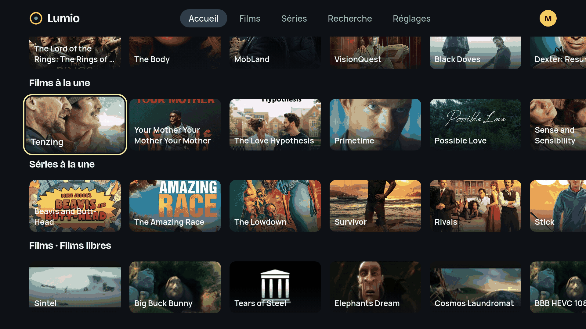
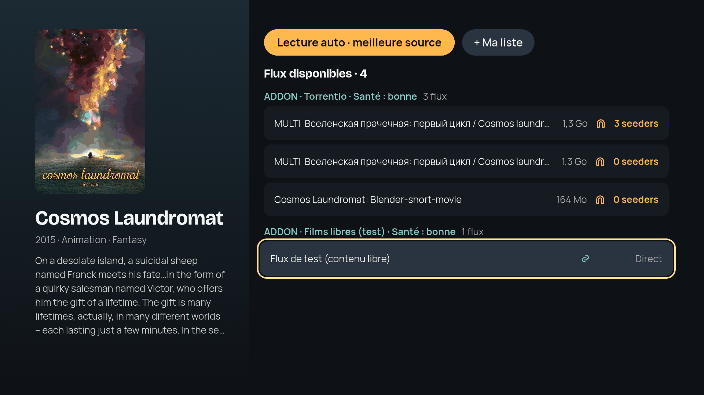
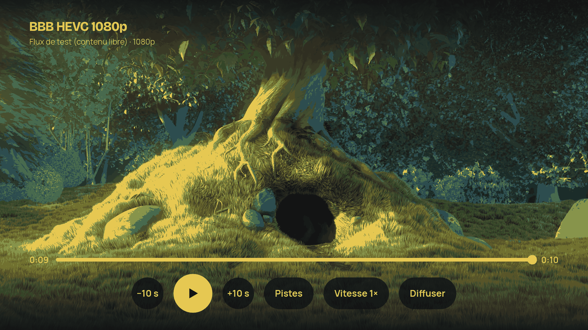
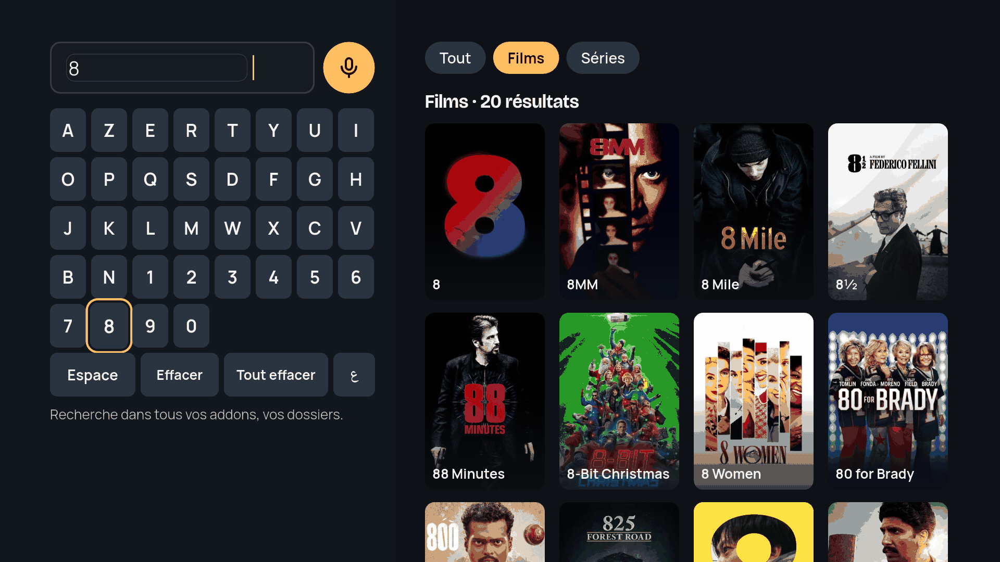
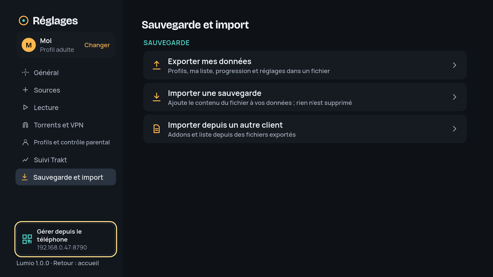
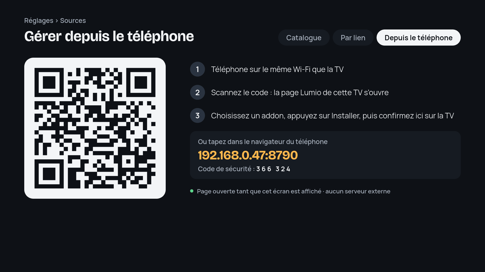

# Lumio

Client média libre compatible avec le protocole d'addons de Stremio, pensé
pour la télécommande. Lumio est **Android uniquement** (Android TV et
téléphone), sans synchronisation ni compte.

> **Statut (19 novembre 2026) : fonctions et interface TV terminées, validation
> sur la box en cours.** Toutes les phases du plan sont réalisées, l'interface
> TV a été refaite écran par écran d'après les maquettes, et un test global de
> bout en bout a été joué sur émulateur
> ([compte rendu](docs/rapports/2026-11-19-test-global-emulateur.md)). La
> vérification sur une vraie box Android TV est en cours (fluidité du lecteur,
> HEVC, portail depuis le téléphone). Aucune version publiée pour l'instant.

Lumio est un projet indépendant, **non affilié à Stremio**. « Compatible avec
le protocole d'addons » décrit uniquement l'interopérabilité technique.

## Ajouter un addon

Réglages › Sources › **Ajouter un addon**, trois onglets :

- **Catalogue** : les addons du site communautaire stremio-addons.net
  (hors ligne : dernière liste en cache ou liste officielle de secours).
- **Par lien** : collez ou tapez le lien `manifest.json` (ou `stremio://`),
  l'aperçu s'affiche, puis **Installer**.
- **Depuis le téléphone** : sur le Wi-Fi de la maison, sans serveur externe.
  Scannez le QR affiché sur la TV (ou tapez l'adresse `IP:8790` dans le
  navigateur du téléphone et saisissez le code à 6 chiffres), collez le lien
  d'addon dans la page, **Envoyer à la TV**, puis confirmez l'installation
  sur la TV. La même page permet de réordonner, activer/désactiver et
  supprimer vos addons. La carte « Gérer depuis le téléphone » du rail des
  Réglages ouvre directement cet onglet.

La page du téléphone n'existe que tant que l'onglet est affiché (arrêt à la
sortie de l'écran et après 10 minutes sans activité), n'est jamais servie sur
un VPN ni sur le réseau mobile, est protégée par un code renouvelé à chaque
ouverture, et ne reçoit jamais l'adresse d'un addon.

L'adresse `IP:8790` n'est affichée qu'une fois l'écran « Gérer depuis le
téléphone » ouvert (OK sur la carte du rail) : tant que cet écran n'est pas
ouvert, rien n'écoute sur la TV et le navigateur affichera « connexion
refusée » (ERR_CONNECTION_REFUSED). Cette erreur est produite par le
navigateur lui-même, Lumio ne peut pas la remplacer par une page : ouvrez
l'écran sur la TV, laissez-le ouvert pendant que vous utilisez le téléphone,
puis rechargez la page. Détails :
`docs/superpowers/specs/2026-11-19-page-web-box-design.md`.

## Fonctionnalités

- **Addons** : protocole d'addons (catalogues, fiches, flux, sous-titres),
  agrégation de plusieurs addons (voir « Ajouter un addon » ci-dessous).
- **Lecture** : lecteur plein écran pensé pour la télécommande (D-pad) et la
  souris, pistes, sous-titres, reprise, épisode suivant.
- **Torrents** : moteur intégré (libtorrent), lecture de magnets en streaming,
  cache disque, confidentialité réseau (VPN requis ou avertissement).
- **Sources locales** : dossiers locaux et Jellyfin.
- **Profils** : profils avec code PIN et contrôle parental.
- **Sauvegarde** : export et import locaux d'un fichier (adresses d'addons
  chiffrées par phrase secrète) ; import depuis Stremio. Pas de synchronisation
  ni de compte.
- **Qualité des sources** : santé des addons, tri et dédoublonnage des flux,
  basculement automatique vers une autre source.
- **Suivi** : Trakt (seul), calendrier des sorties.
- **Partage** : cast DLNA, watch-party.

Lumio **ne fournit, ne suggère et ne recherche aucune source** : aucun addon
n'est préinstallé, aucun scraper n'est inclus. Voir
[l'avertissement](docs/AVERTISSEMENT.md).

## Avancement

Le détail est dans la [feuille de route](docs/feuille-de-route.md). Le plan
compte 41 tâches (numérotées de 1 à 43, les tâches 32 et 33 ayant été
retirées) ; toutes sont réalisées.

| Phase | Contenu | État |
|---|---|---|
| 0 — Socle | Monorepo et CI, addons simulés, backend de comptes, mises à jour, spike torrents | Terminée |
| 1 — MVP | Protocole d'addons, lecteur, focus TV, profils, accueil, recherche, torrents | Terminée |
| 2 — « En mieux » | Synchronisation, chiffrement, import Stremio, confidentialité, santé et tri des sources | Terminée |
| 3 — Extensions | Dossiers locaux, Jellyfin, Trakt, calendrier, DLNA, watch-party | Terminée |
| Recentrage | Android seul ; synchronisation, comptes, Simkl et versions bureau retirés | Terminé |
| Interface TV | Refonte complète d'après les maquettes (68 écrans et pop-ups), audit à la télécommande | Terminée |
| Addons | Catalogue intégré (stremio-addons.net + addons officiels), portail web servi par la TV, réglage des addons depuis le téléphone | Terminé |
| Test global | Parcours complet sur émulateur : addons, lecture, sous-titres, reprise, séries, anime | Terminé |
| Validation sur la box | Écrans, fluidité, HEVC, portail, torrents 1080p, endurance 8 h | En cours |
| À venir | VPN WireGuard intégré (configuré depuis le portail), guides pas à pas, Trakt sur le portail | Prévu |

## Captures d'écran

Captures réelles prises sur une box Android TV (1920×1080) :
[docs/captures/box/](docs/captures/box/).

| Accueil | Fiche et sources | Lecteur |
|---|---|---|
|  |  |  |
| **Recherche** | **Réglages** | **Gérer depuis le téléphone** |
|  |  |  |

Les maquettes de chaque écran sont dans [docs/design/maquettes/](docs/design/maquettes/).

## Installation rapide

Il n'y a pas encore de version publiée. Pour construire l'APK Android à partir
des sources :

```sh
git clone <url-du-dépôt> lumio && cd lumio/app
flutter pub get
flutter build apk --release --target-platform android-arm
adb install -r build/app/outputs/flutter-apk/app-release.apk
```

Détails dans [docs/installation.md](docs/installation.md).

## Configuration

Les réglages de construction sont des constantes dans `app/lib/config.dart`.
Toutes sont vides par défaut ; vide signifie que la fonction concernée est
désactivée ou masquée et que rien n'est envoyé.

| Constante | Rôle |
|---|---|
| `partyServerUrl` (`--dart-define=PARTY_SERVER_URL=…`) | URL https du serveur des salles de watch-party ; vide = watch-party masquée |
| `traktClientId` (`--dart-define=TRAKT_CLIENT_ID=…`) | Application Trakt publique (identifiant par défaut fourni, pas de secret requis) |
| `traktClientSecret` (`--dart-define=TRAKT_CLIENT_SECRET=…`) | Facultatif ; n'est envoyé que s'il est renseigné |
| `updateManifestUrl` | Manifeste de mise à jour `{version, apk, sha256}` ; vide = pas de bannière |

## Serveur des salles de watch-party

`backend/` ne contient que le Worker des salles (Durable Object), sans compte.
Il est optionnel (détail dans [docs/backend.md](docs/backend.md)) :

1. Créer le KV `RATE` et remplacer l'identifiant factice de
   `backend/wrangler.jsonc`.
2. `cd backend && npx wrangler deploy`.
3. Compiler l'application avec `--dart-define=PARTY_SERVER_URL=https://…`.

## Limites connues

- Les flux HLS ne peuvent pas être diffusés par cast DLNA.
- Sans clé TMDB, certaines fiches n'ont pas d'affiche.
- Un profil enfant ne voit que les titres dont la classification est connue :
  les séries Jellyfin sans classement sont masquées.
- Pas de reconnexion automatique à Jellyfin si la session expire.
- La signature de l'APK de test est celle de débogage.
- Non validé sur appareil : voir le
  [rapport de vérification](docs/rapports/2026-11-18-verification-finale.md).

## Documentation

- [Architecture](docs/architecture.md)
- [Compatibilité avec les addons](docs/compatibilite-addons.md)
- [Installation](docs/installation.md)
- [Développement](docs/developpement.md)
- [Serveur des salles](docs/backend.md)
- [Sécurité](docs/securite.md) et [SECURITY.md](SECURITY.md)
- [Torrents et confidentialité](docs/torrents-et-confidentialite.md)
- [Feuille de route](docs/feuille-de-route.md)
- [Vérification finale](docs/rapports/2026-11-18-verification-finale.md)
- [Avertissement](docs/AVERTISSEMENT.md)
- [Contribuer](CONTRIBUTING.md) et [journal des modifications](CHANGELOG.md)

## Licence

Lumio est distribué sous licence GNU GPL-3.0, voir [LICENSE](LICENSE). La
dépendance au moteur de torrents (GPL-3.0) impose cette licence.

## Avertissement légal

Lumio ne fournit ni n'héberge aucun contenu ni aucun addon. Vous êtes
responsable des sources que vous ajoutez et du respect du droit d'auteur dans
votre pays. Voir [docs/AVERTISSEMENT.md](docs/AVERTISSEMENT.md).

---

## English summary

Lumio is a free (GPL-3.0) media client compatible with the Stremio addon
protocol, Android only (Android TV and phone), no sync and no account
(Flutter), with a built-in addon catalogue and a local web portal served by
the TV to add and configure addons from a phone. Features: addon aggregation, built-in torrent streaming
(libtorrent), local folders, Jellyfin, profiles with PIN and parental control,
local backup, Stremio import, torrent
privacy (VPN), addon health and source ranking with fallback, Trakt,
release calendar, DLNA cast, watch-party.

**Status: features and TV interface done, end-to-end test passed on an
emulator, validation on a real Android TV box in progress.** No release yet.

Lumio ships no addon and no content, includes no scraper, and is not affiliated
with Stremio. You are responsible for the sources you add and for complying
with copyright law in your country. Documentation is in French, see `docs/`.
