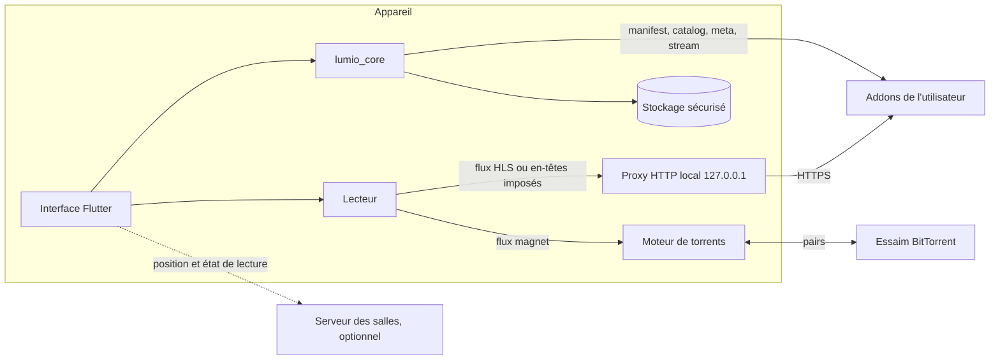

# Architecture

Ce document décrit l'architecture visée par la conception. Les éléments non
encore construits sont signalés « prévu ».

## Monorepo

```
packages/lumio_core/   Dart pur, testable sans Flutter
app/                   Application Flutter (Android seul)
backend/               Cloudflare Worker des salles de watch-party (Hono, KV, Durable Object)
scripts/               Garde-fous (disque, licences, essai sur la box)
docs/                  Documentation, spécification, plan, rapports
```

### `packages/lumio_core`

Logique métier sans dépendance à Flutter, pour des tests rapides sans appareil.

Existant :
- modèles et lecture stricte des manifests d'addons ;
- client d'addons (délai, nouvelle tentative, taille maximale) ;
- normalisation des URL d'addons et garde SSRF ;
- récupérateur HTTP sécurisé (redirections contrôlées) ;
- vérification des mises à jour (comparaison de versions, empreinte SHA-256) ;
- construction de magnets à partir d'un infoHash ;
- `redactUrl` pour ne jamais journaliser d'URL complète ;
- serveur d'addons simulé pour les tests.

Prévu : agrégation de catalogues, fiches fusionnées, normalisation des flux,
sous-titres, tri et dédoublonnage des sources, santé des addons, règles de progression, profils, sauvegarde locale,
chiffrement, import.

### `app`

Application Flutter, identifiant `dev.lumio.app`.

Existant : squelette, composant d'état (chargement, vide, erreur), bannière de
mise à jour, interface `TorrentEngine` avec adaptateur `TorrServer`
et écran de debug d'essai du moteur.

Prévu : interface (Riverpod, go_router), lecteur (media_kit), base locale
(drift), stockage sécurisé des secrets, proxy HTTP local, navigation D-pad,
intégrations.

### `backend`

Worker Cloudflare optionnel, nécessaire seulement pour la watch-party (salles
anonymes, sans compte). Voir [backend.md](backend.md).

## Flux de données



Parcours typique (prévu) : l'utilisateur ajoute l'URL d'un addon, Lumio lit son
manifest et le valide ; l'accueil interroge les catalogues de tous les addons
en parallèle, une erreur d'un addon n'empêche pas les autres ; à la lecture,
les flux sont normalisés puis le lecteur reçoit soit une URL directe, soit une
URL du proxy local, soit une URL du moteur de torrents.

## Proxy HTTP local (prévu)

Le spike a montré que libmpv échoue sur certains flux HLS en HTTPS (échec TLS).
Plutôt que reconstruire libmpv, un petit serveur HTTP écoute sur `127.0.0.1` :
les requêtes HTTPS sont faites par Dart et servies au lecteur, avec prise en
charge des plages d'octets, réécriture des playlists `.m3u8` et ajout des
en-têtes exigés par un addon. Seules les connexions locales sont acceptées.

## Moteur de torrents

Interface `TorrentEngine` (ajout d'un magnet ou infoHash, liste de fichiers,
URL de flux locale à plages d'octets, statut, arrêt avec suppression des
données). L'implémentation actuelle (`TorrServerEngine`) pilote TorrServer MatriX.150
(épinglé, binaire officiel vérifié par SHA-256) par son API HTTP locale ; le
processus est lancé par `TorrServerManager` (Kotlin), sur 127.0.0.1 avec mot de
passe aléatoire. Elle remplace libtorrent_flutter 1.7.5 (débit 20 à 60 fois
inférieur sur la box). L'interface permet de basculer sur un autre moteur si
nécessaire. Voir
[torrents-et-confidentialite.md](torrents-et-confidentialite.md).

## Pas de synchronisation

Décision du 2026-11-18 : Lumio ne synchronise rien entre appareils et n'a pas de
compte. Les données (profils, ma liste, progression, addons) restent sur
l'appareil ; les adresses d'addons sont dans le stockage sécurisé local. La
sauvegarde se fait par fichier (export et import locaux).
